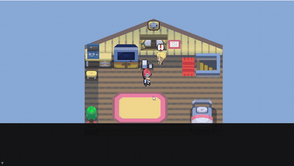
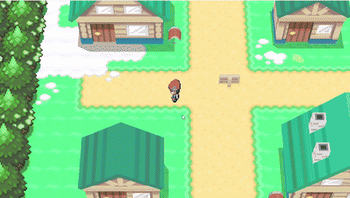
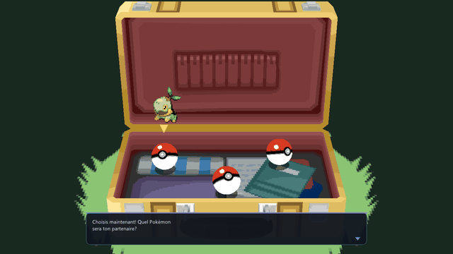
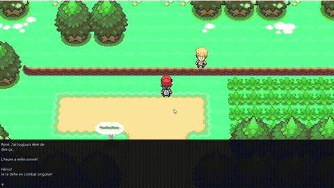
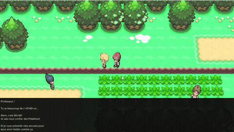
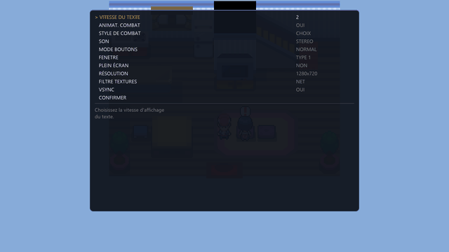

<h1 align="center">OpenPlatinum</h1>

<p align="center">
  <b>A from-scratch native engine for Pokémon Platinum.</b><br>
  Reads your own <code>.nds</code> dump and runs the real game data on a C++17 / SDL3 / OpenGL engine.<br>
  It doesn't emulate an ARM CPU, recompile the original code or use any emulator core.
</p>

<p align="center">
  
  
  
  
  
  
  <a href="https://github.com/shinzarou-eng/OpenPlatinum/releases/latest"></a>
</p>

<p align="center">
  <b><a href="https://github.com/shinzarou-eng/OpenPlatinum/releases/latest">⬇ Download the Windows build</a></b>
  — drop your own Platinum <code>.nds</code> (FR or US) next to the exe and play.
</p>

| Opening | Twinleaf Town |
|---|---|
|  |  |
| **Starter selection** | **Battle** |
|  |  |
| **Route 202** | **Options** |
|  |  |

<sub>Captured from the engine. Every map, NPC, line of dialogue, 3D model and cutscene above is
driven by the game's own data, loaded at runtime from the ROM. None of it was hand-placed.</sub>

---

## What this is

OpenPlatinum reimplements the Pokémon Platinum field engine natively, in the same spirit as
OpenRCT2 or OpenMW. The original executable code is never run. The engine parses the cartridge
filesystem and Nitro formats itself:

- maps and 3D models
- collision and tile behaviors
- event scripts
- the encrypted text banks and sprites
- trainer and Pokémon data

Then it executes the game's scripts on its own VM.

The [pret/pokeplatinum](https://github.com/pret/pokeplatinum) decompilation is the reference for
behavior. When the engine does something, it should be the thing `field_control.c` or
`scrcmd.c` does, and the comments in the source point at the function they mirror.

Works with the **French** (`CPUF`) and **US** (`CPUE`) releases — the data formats are identical
between regions, so every map, script and battle comes out the same and the in-game text simply
follows the ROM you load. The port's own interface supports French and English
(Options → LANGUE/LANGUAGE, auto-detected from the ROM region on first launch).

## Status

Playable from the opening in the bedroom through the Lake Verity scene and the first battles.
The starter-selection scene renders the game's own 3D models with the real DS camera work.
Beyond that, maps load and can be walked, but story progression past the starter isn't
implemented yet.

| Subsystem | State | Notes |
|---|---|---|
| NDS filesystem, NARC | ✅ Done | FAT/FNT, BTAF/BTNF/GMIF, cached members |
| Map matrix + streaming | ✅ Done | Seamless overworld, cells loaded and unloaded around the player, zone switching |
| NSBMD models / TEX0 | ✅ Done | Terrain, buildings and props, area texture sets |
| Collision and tile behaviors | ✅ Done | BDHC heights, attribute bits, ledges |
| Player movement | ✅ Done | DS step machine: turn, walk, run, bump, jump timings |
| Warps | ✅ Done | Behavior-gated like the DS: doors, mats, stairs, escalators, panels; arrival facing; `0x100` return warps |
| Event script VM | ✅ Done | **372/372** opcodes in use by the game, Platinum widths, variable-arity commands |
| Objects / NPCs | ✅ Done | Placement, visibility flags, movement scripts, overworld sprites |
| Coord / BG events | ✅ Done | Triggers, signs, hidden items |
| Game text (FR/US) | ✅ Done | `pl_msg` decryption, Gen 4 charmap, `{tag}` substitution, text follows the loaded ROM |
| BCA prop/model animation | ✅ Done | NSBCA replay: doors, the suitcase opening, bouncing Poké Balls |
| Starter selection scene | ✅ Done | Real `ev_pokeselect` models: suitcase, three balls, platform, DS camera move and confirmation zoom, animated Pokémon above the chosen ball, `pl_msg` bank 360, Yes/No |
| Pokémon sprites | ✅ Done | `pl_pokegra` decryption, both 80×80 animation frames ping-ponged like the DS |
| Blackout / respawn | ✅ Done | `sSpawnLocations` table: last visited Pokémon Center remembered, healed on wake, fade + warp |
| In-game options | ✅ Done | DS rows (text speed, battle anim/style, sound, buttons, frame type) + native graphics: language (FR/EN), fullscreen, resolution, texture filter, antialiasing (MSAA), anisotropy, VSync. Saved to `options.cfg` |
| Save data | 🟡 Partial | Save file exists (map, position, party, respawn point) |
| Wild encounters | 🟡 Partial | Real tables and rates — grass and Surf sections of `pl_enc_data` |
| Battles | 🟡 Partial | Real stats, moves, type chart, damage formula, animated sprites, wild and trainer battles, ball capture (Gen 4 formula). Battle scenes use the ROM's `pl_batt_bg`/`pl_batt_obj` data per map. No XP or doubles yet |
| Field moves | 🟡 Partial | Surf end-to-end: badge + party gating, mount/dismount, swim sprite, water encounters |
| X menu / Bag / Party / Save | 🟡 Partial | Functional screens, item bag pockets, on-going polish |
| Field texture loops (`fldtanime`) | ⬜ Todo | Animated water/flowers BTX0 per-area |
| Audio (SDAT) | ⬜ Todo | |
| Pokédex, key items | ⬜ Todo | |

## Getting started

### Requirements

- Windows 10/11, x86-64
- [w64devkit](https://github.com/skeeto/w64devkit) (MinGW-w64 GCC), [Meson](https://mesonbuild.com) + [Ninja](https://ninja-build.org)
- [SDL3](https://github.com/libsdl-org/SDL/releases) MinGW development package
- A local [pokeplatinum](https://github.com/pret/pokeplatinum) checkout. It's needed once, to
  generate the map header table.
- **Your own dump** of Pokémon Platinum (France or US)

### Build

Extract w64devkit and SDL3 under `cpp/tools/`, then:

```bat
cd cpp
python ..\tools\gen_headers.py C:\path\to\pokeplatinum
build.bat
```

The output is `cpp/builddir/OpenPlatinum.exe`, with `SDL3.dll` and `data/headers.bin` next to it.
Dear ImGui is vendored in `cpp/thirdparty/`.

### Run

Put the ROM in `rom/` at the repository root (any `*.nds` filename), or pass it explicitly:

```bat
cpp\builddir\OpenPlatinum.exe
cpp\builddir\OpenPlatinum.exe --rom "D:\dumps\platinum.nds"
cpp\builddir\OpenPlatinum.exe --map 411 --pos 116,887    REM Twinleaf, in front of the house
```

| Input | Action |
|---|---|
| Arrows / `WASD` (`ZQSD` on AZERTY) | Walk |
| `Shift` | Run (once running shoes are obtained) |
| `Enter` / `Space` / `E` | Interact / confirm |
| `Backspace` / `Q` | Cancel |
| `X` | Menu (Pokédex, Pokémon, Bag, Save, Options) |
| `F1` | Debug menu: teleports, flags, objects, scripts, battles, bag editor |
| `F8` | Start/stop the frame recorder (`_shots/rec/`) |
| `Esc` | Quit |

## Architecture

```
 .nds ──► Nds (FAT/FNT) ──► Narc
                             │
     ┌───────────────────────┼─────────────────────────────┐
     ▼                       ▼                             ▼
 map_matrix ─► headers   zone_event                  scr_seq / pl_msg
     │                   (warps, objects,                  │
     ▼                    coords, bgs)                     ▼
 land_data ─► BDHC +         │                       ScriptVM (372 ops)
 NSBMD + attrs               ▼                             │
     │                  World (streaming, movement,  ◄─────┘
     ▼                   events, warps, camera)
 area_data / build_model     │
     │                       ▼
     └──────────────► Renderer (OpenGL) ◄── mmodel / pl_pokegra / ev_pokeselect
```

| File | Role |
|---|---|
| `nds.cpp` | ROM mount, NARC parsing, matrices, headers, zone events |
| `land.cpp` | `land_data`: terrain mesh refs, BDHC, tile attributes, props |
| `bmd.cpp` | NSBMD/TEX0/BCA decoding to GPU-ready meshes and animations |
| `world.cpp` | Map loading, headers, cell streaming, save/load |
| `world_render.cpp` | Map/prop meshes, billboards, camera, starter 3D scene |
| `world_collision.cpp` | Raycasts, BDHC attributes, ground heights |
| `world_script.cpp` | Script callbacks, dialogue flow, bag/shop, events |
| `world_move.cpp` | ApplyMovement, NPC wandering, trainer sight |
| `world_warp.cpp` | Warp transitions, door/prop animations |
| `world_tick.cpp` | Per-frame world update, encounters, battle start |
| `world_internal.h` | Shared helpers (DS behavior/type enums, coords) |
| `script.cpp` + `op_table.inc` | Event script VM and the Platinum command table |
| `msg.cpp` | Text bank decryption and charmap |
| `spr.cpp` | Overworld and Pokémon sprite decoding |
| `battle.cpp` | Battle engine |
| `render.cpp` | OpenGL backend |

## Findings worth knowing

Notes written while pulling the game apart. Several of these correct tables that circulate online.

- **Most opcode tables floating around are Diamond/Pearl's, not Platinum's.** Using them
  desynchronizes the script stream within a few commands. Every width here was re-derived from the
  `ScrCmd_*` handler bodies. Eight commands (`CallTVBroadcast`, `DoStrength/Flash/DefogFunc`, …)
  read a selector and then a *variable* number of arguments.
  → [docs/script-vm.md](docs/script-vm.md)
- **`ObjectEvent.y` is a raw `fx32`, not a tile offset.** The DS seeds the position with it and
  `RecalculateObjectHeight` then replaces it with the BDHC ground height. Treating it as tiles puts
  NPCs hundreds of units in the air.
  → [docs/maps.md](docs/maps.md)
- **Overworld graphics IDs don't index `mmodel.narc` directly.** The mapping goes through
  `field_sprites.order`: the player is member 90 and Mom is member 119, not 0 and 140.
  → [docs/sprites.md](docs/sprites.md)
- **`pl_pokegra` sprites** are LCRNG-encrypted, linear 160×80 sheets holding two 80×80 frames —
  which is why every Pokémon in the game animates.
  → [docs/sprites.md](docs/sprites.md)
- **Warps are gated by tile behavior, not by position.** Doors need a push into a blocked door
  tile. Mats and stairs need a push in their direction. Only north warps, escalators and warp
  panels fire on step. Arrival keeps the entry direction, and a south arrival walks one tile out.
  → `World::_warp_depart` / `_tick_warp`
- **The starter scene is fully 3D.** `ev_pokeselect.narc` holds the animated suitcase (played once,
  then swapped for a static open model), three ball models with their own bounce animations, and a
  scaled platform. The camera itself animates: distance 300→200, pitch −30°→−50°, on confirm.
  → `choose_starter_app.c` / `World::draw_starter`
- **Blackout doesn't warp to a fixed map.** The DS keeps a `blackOutWarpId` in the saved overworld
  state, updated on every healing-map entry from a 20-entry table (17 Pokémon Centers, the player's
  bedroom, two others). Losing a battle fades out and respawns there facing north.
  → `spawn_locations.c` / `World::_blackout_id`
- Battle data layouts: `trdata`, `trpoke`, `pl_personal`, `wotbl`, `pl_waza_tbl`.
  → [docs/battle-data.md](docs/battle-data.md)

## Tooling

| Tool | Purpose |
|---|---|
| `tools/gen_headers.py` | Builds `headers.bin` from the decomp's `map_headers.h`, resolving composed weather/map-type constants |
| `tools/audit_opcodes.py` | Walks all 2,698 script functions in the ROM and reports any opcode the VM lacks (currently none) |
| `tools/romlib.py` | Minimal NDS/NARC reader shared by the tools |
| `tools/make_gif.py` | Turns the engine's `--gif` frame dumps into an animated GIF |

The engine also has a headless-friendly test harness for reproducing a scene deterministically:
`--map` `--pos` `--walk` `--talk` `--tp` `--shot` `--gif` `--starter` `--ui` `--wild` `--verbose`,
plus debug environment variables (`SCRTRACE`, `WARPDBG`, `WARPAUDIT`, `OBJDBG`, `SNAPDBG`,
`MOVDBG`, `WILD1`, …).

## Roadmap

- [x] Field engine: maps, collision, movement, objects, events, warps
- [x] Script VM covering every command the game uses
- [x] BCA animations: doors, props, starter scene
- [x] Starter selection: real models, DS camera, animated Pokémon
- [x] Options menu: DS rows + native graphics settings
- [x] Blackout respawn at Pokémon Centers
- [ ] Field texture loops (`fldtanime`): animated water, flowers
- [ ] SDAT audio: SSEQ/SBNK/SWAR sequencer, field BGM, cries
- [ ] Professor intro and new-game flow
- [ ] Sandgem progression and beyond
- [ ] Battle engine: XP and level-up, capture, items, trainer AI, double battles
- [ ] Pokédex, key items, trading
- [ ] Linux / macOS builds

## FAQ

**Why not just use an emulator?**
Emulators are the right tool for playing the game as it was. This project is about understanding
the engine well enough to rebuild it. A native engine also opens up things an emulator can't do
cleanly: arbitrary resolutions, widescreen, modern input, and readable code for every system.

**How is this different from a static recompilation?**
Recomp projects translate the original ARM code and still need an emulated DS (usually melonDS)
for graphics, sound and the ARM7. OpenPlatinum shares no code with the original binary. Everything
is reimplemented against the decompilation's documented behavior.

**Does it work with the US version?**
Yes. The NARC archive layout is identical between regions, so a US dump (`CPUE`) loads the same
way — maps, scripts, battles — and all in-game text comes out in English automatically. Other
regional releases should behave the same.

## Legal

This repository contains **no ROM, no game assets and no data extracted from the game**.
`headers.bin` is generated locally from the decompilation, and the GIFs above are captures of this
engine running. You must supply your own legally obtained dump of Pokémon Platinum.

The engine source is released under the [MIT license](LICENSE). Pokémon and Pokémon Platinum are
trademarks of Nintendo, Creatures Inc. and GAME FREAK inc. This is an unaffiliated, non-commercial
research project.

## Acknowledgements

- [pret/pokeplatinum](https://github.com/pret/pokeplatinum), the decompilation this engine is
  checked against
- [Dear ImGui](https://github.com/ocornut/imgui), [SDL](https://www.libsdl.org)
