<h1 align="center">OpenPlatinum</h1>

<p align="center">
  <b>A from-scratch native engine for Pokémon Platinum.</b><br>
  Reads your own <code>.nds</code> dump and runs the real game data on a C++17 / SDL3 / OpenGL engine.<br>
  It doesn't emulate an ARM CPU, recompile the original code or use any emulator core.
</p>

<p align="center">
  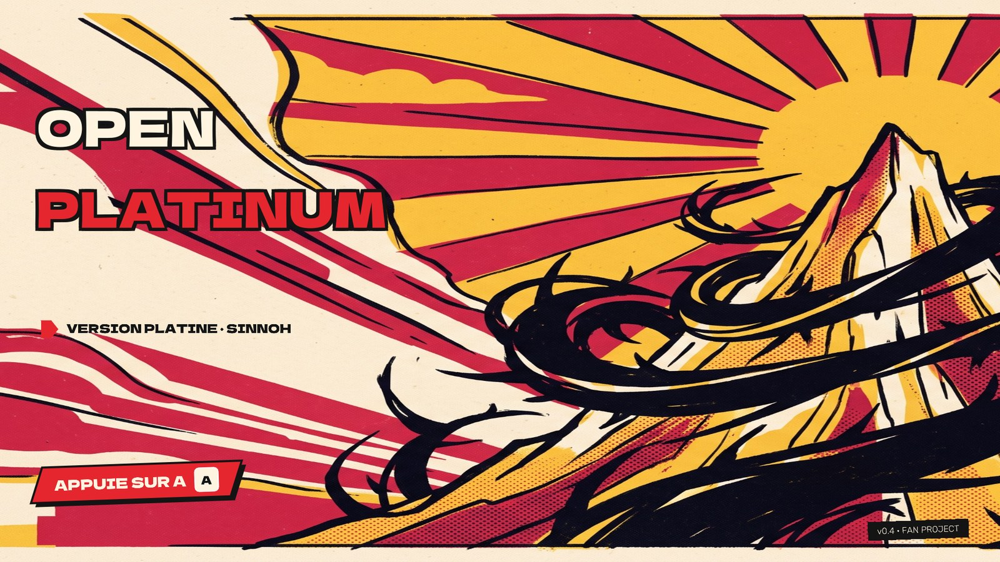
</p>

<p align="center">
  
  
  
  
  
  <a href="https://github.com/shinzarou-eng/OpenPlatinum/releases/latest"></a>
</p>

<p align="center">
  <b><a href="https://github.com/shinzarou-eng/OpenPlatinum/releases/latest">⬇ Download for Windows / macOS</a></b>
  — drop your own Platinum <code>.nds</code> (FR or US) in <code>rom/</code> and play.<br>
  <a href="https://openplatinum.pages.dev">Website</a>
</p>

| Twinleaf Town | Battle |
|---|---|
| 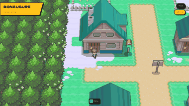 | 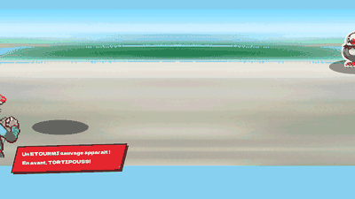 |

<sub>Captured from the engine. Every map, NPC, line of dialogue, 3D model and cutscene above is
driven by the game's own data, loaded at runtime from the ROM. None of it was hand-placed.</sub>

| Sandgem town | Route 215 — walking Pokémon |
|---|---|
| 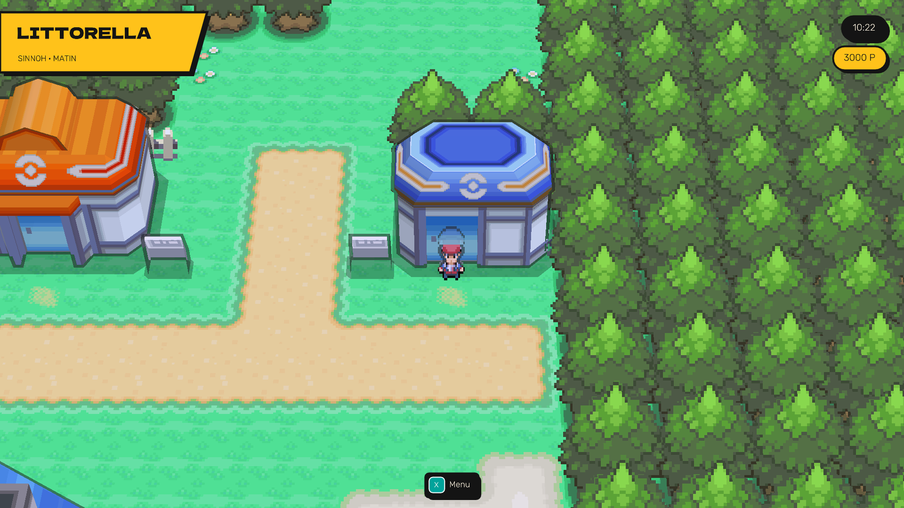 | 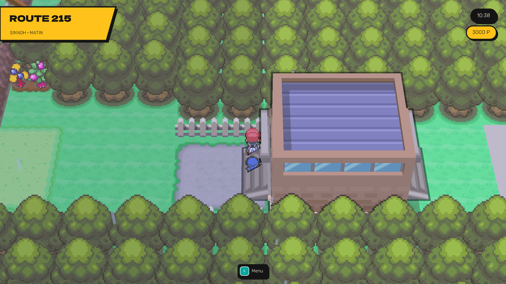 |
| **Same town, at night** | **Route in the morning** |
| 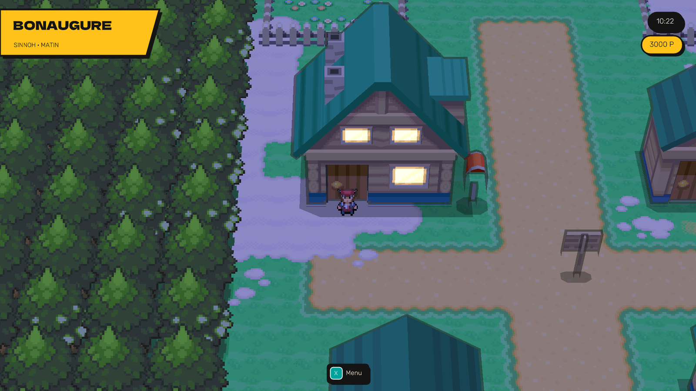 | 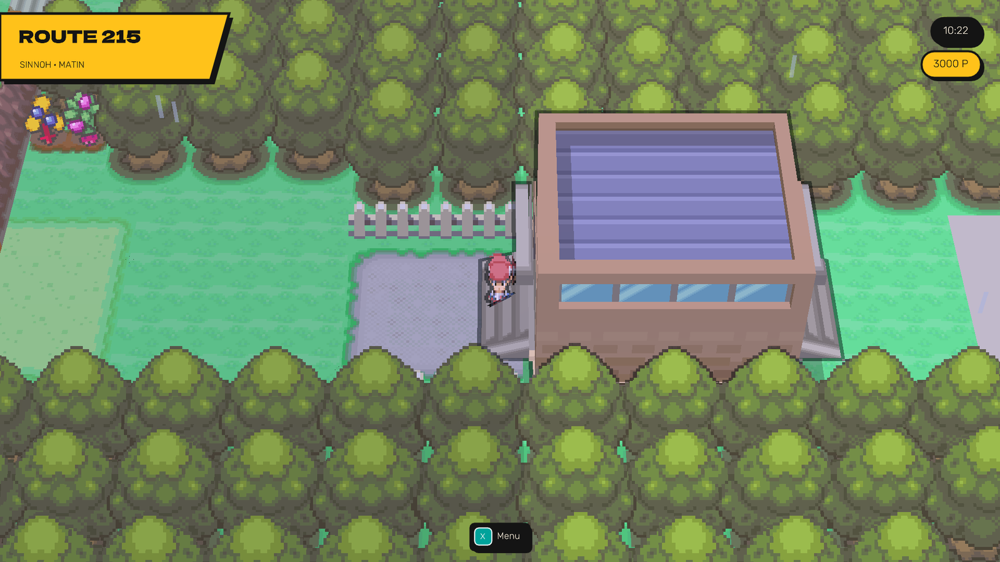 |
| **Starter selection** | **Dialogue** |
| 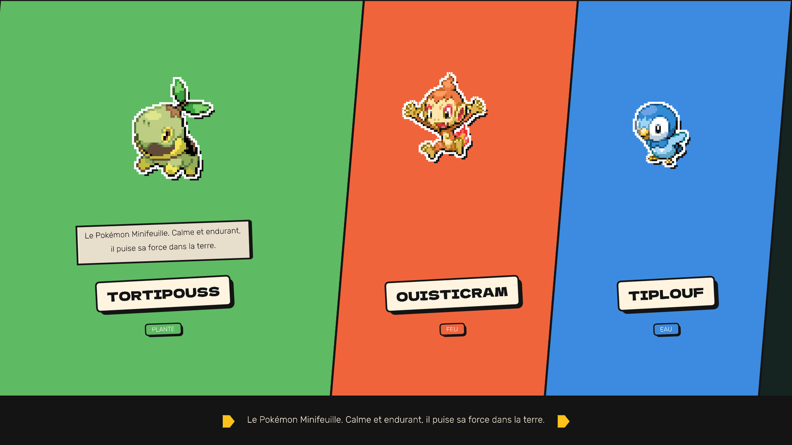 | 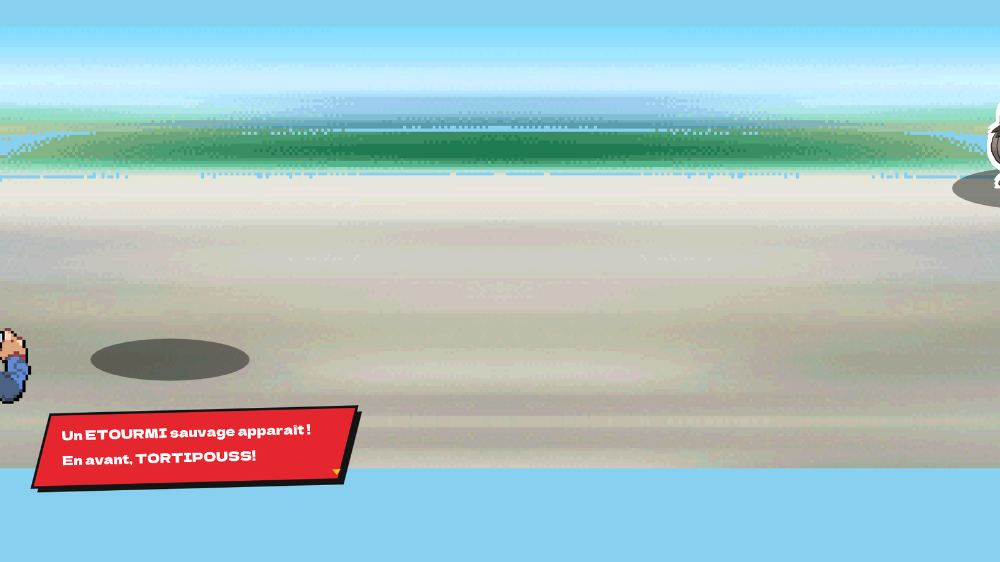 |
| **Trainer battle** | **Move selection** |
| 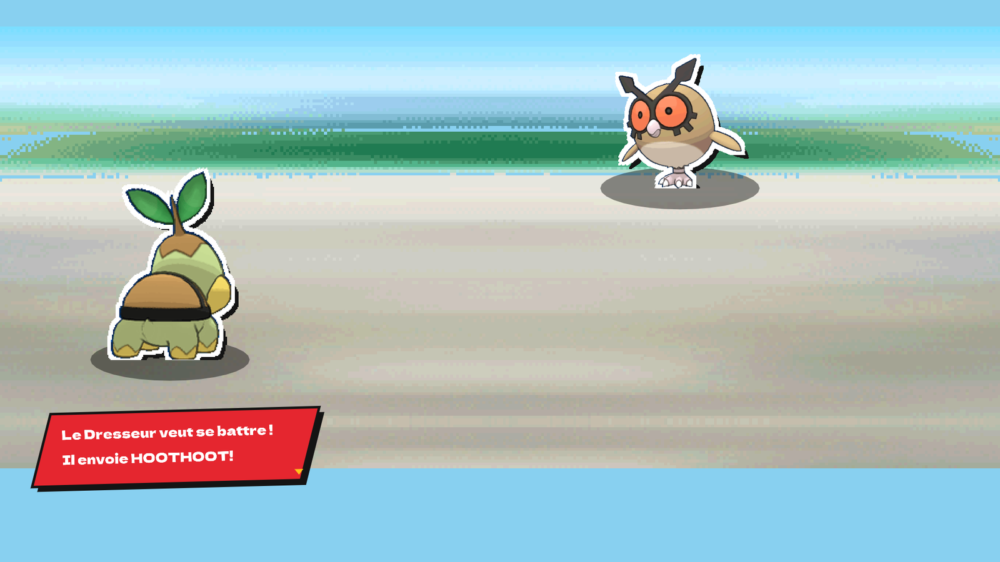 | 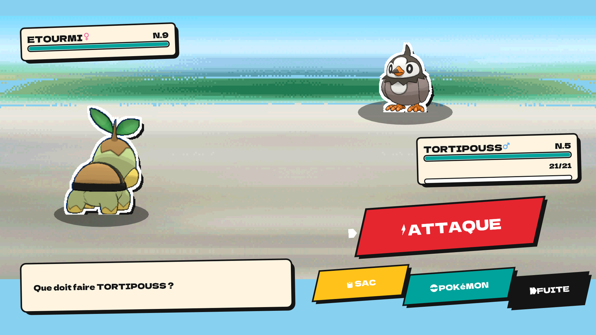 |
| **Wild battle** | **Pokémon Center** |
| 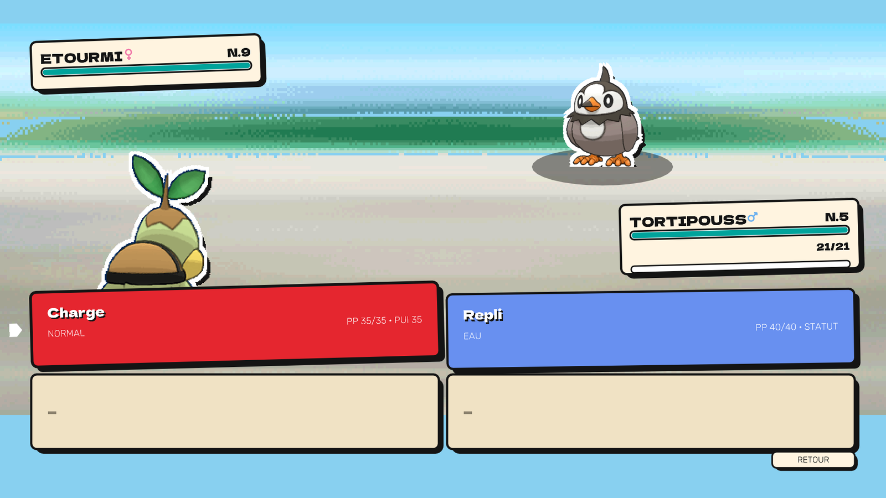 | 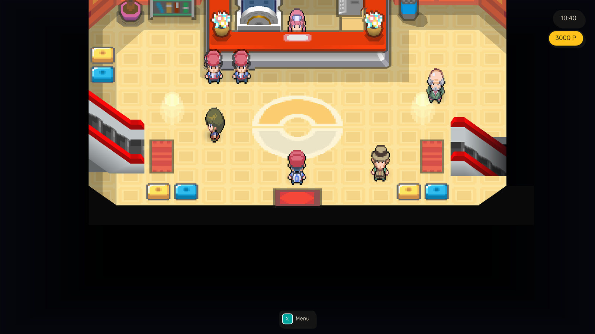 |

| Pokédex | Party |
|---|---|
| 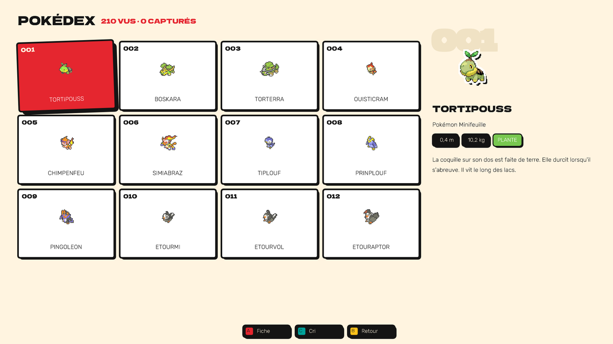 | 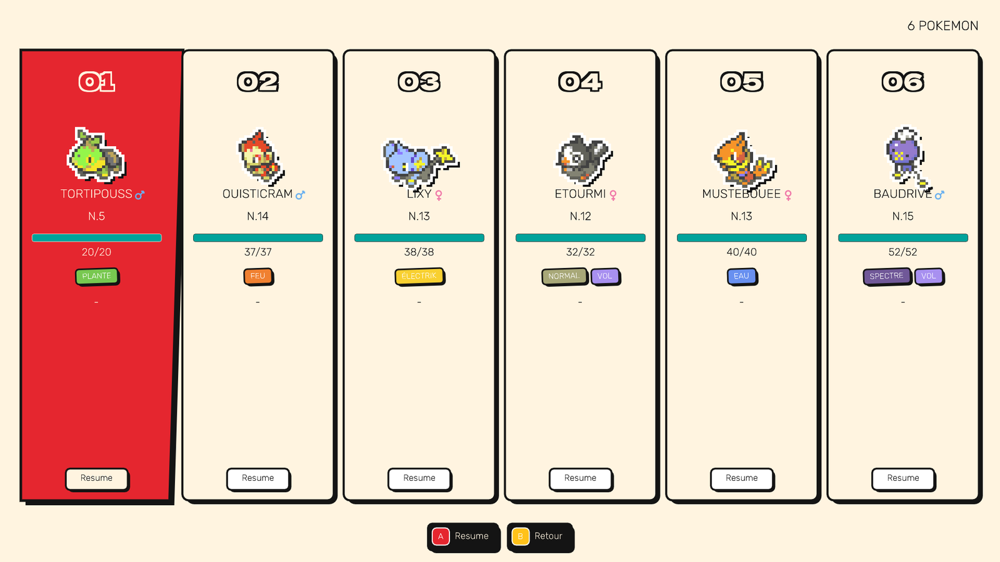 |
| **Bag** | **PC boxes** |
| 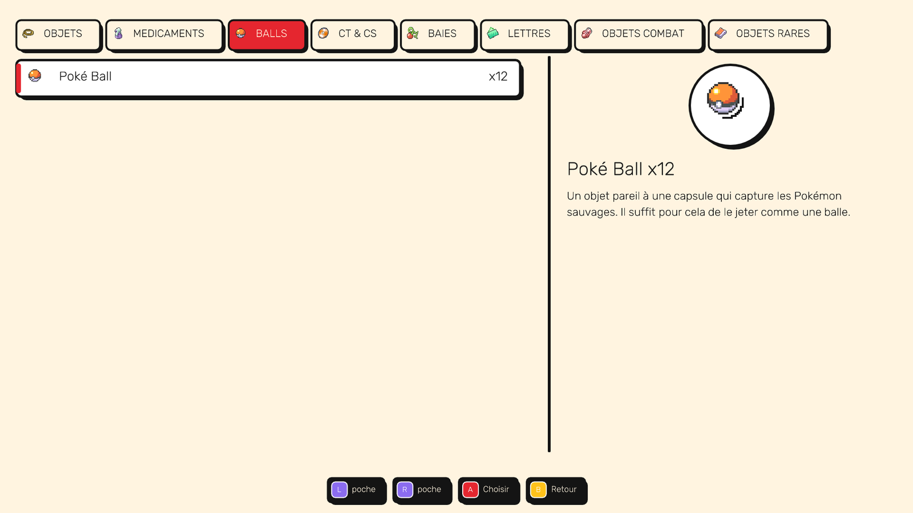 | 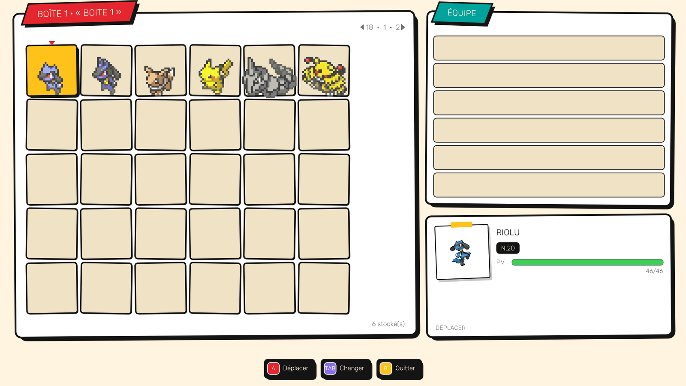 |
| **Pokétch** | **Télé Motisma (in-game TV)** |
| 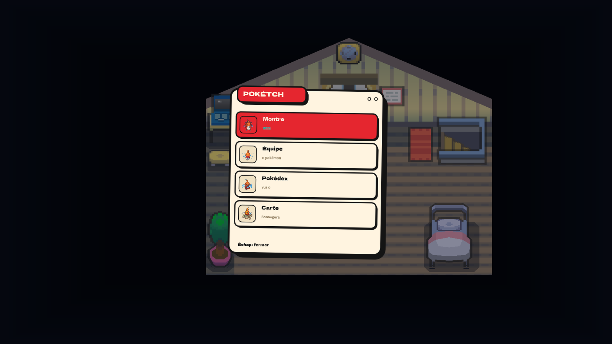 | 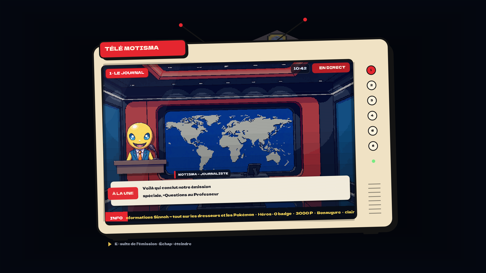 |

## What this is

OpenPlatinum reimplements the Pokémon Platinum field engine natively, in the same spirit as
OpenRCT2 or OpenMW. The original executable code is never run. The engine parses the cartridge
filesystem and Nitro formats itself:

- maps and 3D models
- collision and tile behaviors
- event scripts
- the encrypted text banks and sprites
- trainer and Pokémon data

Then it executes the game's scripts on its own VM.

The [pret/pokeplatinum](https://github.com/pret/pokeplatinum) decompilation is the reference for
behavior. When the engine does something, it should be the thing `field_control.c` or
`scrcmd.c` does, and the comments in the source point at the function they mirror.

Works with the **French** (`CPUF`) and **US** (`CPUE`) releases — the data formats are identical
between regions, so every map, script and battle comes out the same and the in-game text simply
follows the ROM you load. The port's own interface supports French and English
(Options → LANGUE/LANGUAGE, auto-detected from the ROM region on first launch).

The interface ships in three skins — **authentic DS**, **Néo** (navy glass) and a pop-art
**poster theme** (paper, ink, halftone — the one in the screenshots) — switchable in Options.

## Status

The field engine runs end-to-end: maps stream, NPCs wander and talk, signs read, warps work,
wild and trainer battles play on the real DS two-screen layout, and the Pokémon Center PC
opens the genuine storage application through the game's own script. Audio (SSEQ sequencer,
SBNK/SWAR instruments) plays map music, battle themes, effects and cries.

| Subsystem | State | Notes |
|---|---|---|
| NDS filesystem, NARC | ✅ Done | FAT/FNT, BTAF/BTNF/GMIF, cached members |
| Map matrix + streaming | ✅ Done | Seamless overworld, cells loaded and unloaded around the player, zone switching |
| NSBMD models / TEX0 | ✅ Done | Terrain, buildings and props, area texture sets |
| Collision and tile behaviors | ✅ Done | BDHC heights, attribute bits, ledges — matrix-wide grid, offline `--reach` audit |
| Player movement | ✅ Done | DS step machine: turn, walk, run, bump, jump timings |
| Warps | ✅ Done | Behavior-gated like the DS: doors, mats, stairs, escalators, panels; arrival facing; `0x100` return warps |
| Event script VM | ✅ Done | Every opcode the game ships is implemented — full coverage verified by `tools/audit_opcodes.py` across all 2,725 script functions (596 maps) |
| Objects / NPCs | ✅ Done | Placement, visibility flags, movement scripts, overworld sprites |
| Coord / BG events | ✅ Done | Triggers, signs, hidden items |
| Game text (FR/US) | ✅ Done | `pl_msg` decryption, Gen 4 charmap, `{tag}` substitution, text follows the loaded ROM |
| BCA prop/model animation | ✅ Done | NSBCA replay: doors, the suitcase opening, bouncing Poké Balls |
| Starter selection scene | ✅ Done | Real `ev_pokeselect` models: suitcase, three balls, platform, DS camera move and confirmation zoom, animated Pokémon above the chosen ball, `pl_msg` bank 360, Yes/No |
| Pokémon sprites | ✅ Done | `pl_pokegra` decryption, both 80×80 animation frames ping-ponged like the DS |
| Blackout / respawn | ✅ Done | `sSpawnLocations` table: last visited Pokémon Center remembered, healed on wake, fade + warp |
| In-game options | ✅ Done | DS rows (text speed, battle anim/style, sound, buttons, frame type) + native graphics: language (FR/EN), theme (DS/Néo/Pop), fullscreen, resolution, UI scale, texture filter, antialiasing (MSAA), anisotropy, VSync, music volume, autorun, autosave, **key remapping**. Saved to `options.cfg` |
| Save data | ✅ Done | Save v16 (append-tolerant): map, position, party, PC boxes (18×30, empty slots preserved), flags, respawn — plus optional autosave |
| Wild encounters | ✅ Done | Real tables and rates — grass incl. swarm/day/night/radar/dual-slot sections, Surf and fishing (`pl_enc_data`), weather-weighted species |
| Battles | 🟡 Partial | Real DS two-screen layout, `pl_batt_bg`/`pl_batt_obj` per map, DS anchors, HP boxes, touch buttons decoded from ROM graphics, trainer sprites, HD painted backgrounds per terrain with day/night sky, **attack-animation particle engine**, wild and trainer battles, **2v2 doubles** (4-battler engine, native double trainers), XP/level-up, Gen-4 capture including send-to-box when the party is full. No tag partners / trainer AI scoring yet |
| Pokémon storage (PC) | ✅ Done | Real in-world PC: tile-behavior script → boot dialogue → owner menu → operations (deposit/withdraw/move/items), then the storage app; sparse 18×30 boxes, party restrictions kept |
| Field moves | 🟡 Partial | Surf end-to-end (badge + party gating, mount/dismount, swim sprite, water encounters), Rock Climb, Waterfall, Flash, Defog, plus Teleport/Dig/Sweet Scent from the party menu |
| Weather | ✅ Done | Per-map overlays (rain, storm, snow, hail, sandstorm, fog, diamond dust), **dynamic drifting fronts + seasons** (`--weather dyn`), wet ground, snow steps, waves, ROM ambient loops, weather carried into battle, weather-influenced encounters |
| Day / night | ✅ Done | Hour-driven tint (day/dusk/night palettes), lit windows and lamps, period-gated encounter tables, `--time HH` |
| Walking Pokémon | 🟡 Partial | Follower walks behind the player with DS step animation (HGSS-style sprites available) |
| Dynamic map features | 🟡 Partial | `gym_features` wired: Canalave water platforms, Veilstone punching bags + tire stacks, Sunyshore gears, Eterna fans, Iron Island/League lifts, Hearthome DP lift, Villa init |
| Distortion World | 🟡 Partial | DW maps, camera, jumps, boulder puzzle, Giratina shadow event |
| Pokédex | ✅ Done | Regional (210, `pl_pokezukan` order) ↔ national lists, species sheet (sprite, category, height, weight, description), seen/caught tracking |
| In-game TV | 🟡 Partial | Télé Motisma: news, weather and program channels on the house TVs |
| Pokétch | 🟡 Partial | Widget + apps: watch, party, Pokédex counter, map, weather |
| X menu / Bag / Party / Save | 🟡 Partial | Functional screens incl. the real `pl_pst_gra` summary pages and the area encounter list, item bag pockets, on-going polish |
| Player skins | ✅ Done | 20+ selectable heroes, each with overworld + battle-back sprites (`--skin`) |
| Field texture loops (`fldtanime`) | ✅ Done | Per-area BTX0 loops: water, flowers, machines |
| Audio (SDAT) | ✅ Done | SSEQ sequencer + SBNK/SWAR instruments: map BGM, battle themes, sound effects, cries, fanfares |
| Key items, trading | ⬜ Todo | |

<p align="center">
  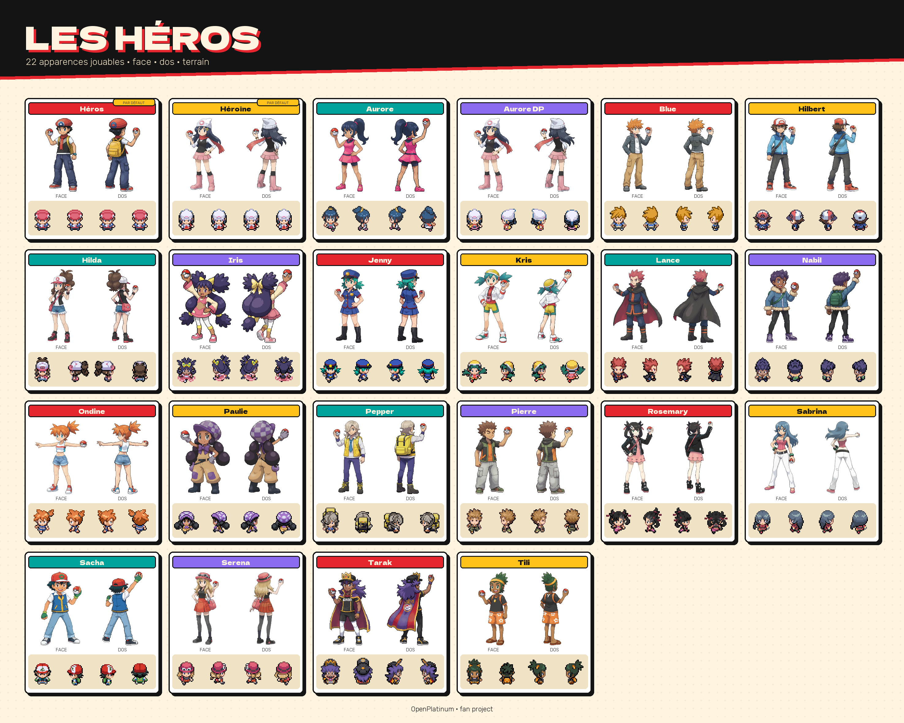<br>
  <sub>Every hero is playable — overworld, battle back and intro portrait all read from the game's own data.</sub>
</p>

## Getting started

### Play a release

Grab the latest zip for your platform from
[releases](https://github.com/shinzarou-eng/OpenPlatinum/releases/latest):

```
OpenPlatinum-win64/
  bin/OpenPlatinum.exe
  data/headers.bin
  ui/…        (fonts & title art)
  battlebg/…  (painted battle backgrounds)
  rom/        ← drop your own .nds here (FR or US)
```

Run `bin/OpenPlatinum.exe` — that's it. On macOS, unsigned binaries trigger
Gatekeeper: right-click → Open, or `xattr -d com.apple.quarantine OpenPlatinum`.

You must supply **your own legally obtained dump** of Pokémon Platinum (France or
US). No ROM, no game data ships in the release.

### Build from source

**Windows** — [w64devkit](https://github.com/skeeto/w64devkit) (MinGW-w64 GCC),
[Meson](https://mesonbuild.com) + [Ninja](https://ninja-build.org), and the
[SDL3](https://github.com/libsdl-org/SDL/releases) MinGW development package.
A local [pokeplatinum](https://github.com/pret/pokeplatinum) checkout is needed
once, to generate the map header table.

Extract w64devkit and SDL3 under `cpp/tools/`, then:

```bat
cd cpp
python ..\tools\gen_headers.py C:\path\to\pokeplatinum
build.bat
```

The output is `cpp/builddir/OpenPlatinum.exe`, with `SDL3.dll` and
`data/headers.bin` next to it. Dear ImGui is vendored in `cpp/thirdparty/`.

**macOS / Linux** — the code is portable (SDL3 + OpenGL 3.3 core, no Win32 API).
macOS arm64 and x86_64 binaries are produced by the `macOS` GitHub workflow on
every push to `main`.

```sh
brew install sdl3 meson ninja        # macOS (Homebrew)
# sudo apt install libsdl3-dev meson ninja-build   # Debian/Ubuntu equivalent

cd cpp
meson setup builddir && ninja -C builddir
./builddir/OpenPlatinum              # run next to rom/ and data/headers.bin
```

### Controls

| Input | Action |
|---|---|
| Arrows / `WASD` (`ZQSD` on AZERTY) | Walk |
| `Shift` | Run (once running shoes are obtained — or autorun) |
| `Enter` / `Space` / `E` | Interact / confirm |
| `Backspace` / `Q` | Cancel |
| `X` | Menu (Pokédex, Pokémon, Bag, Save, Options) |
| `Ctrl` (hold) | Fast-forward dialogue |
| `F6` | Speed ×1→×2→×4→×8 |
| `F1` | Debug menu: teleports, flags, objects, scripts, battles, bag editor |
| `F2` | Collision overlay |
| `F11` / `Alt+Enter` | Fullscreen |
| `F8` | Start/stop the frame recorder (`_shots/rec/`) |

All game keys are remappable in Options → TOUCHES.

## Architecture

```
 .nds ──► Nds (FAT/FNT) ──► Narc
                             │
     ┌───────────────────────┼─────────────────────────────┐
     ▼                       ▼                             ▼
 map_matrix ─► headers   zone_event                  scr_seq / pl_msg
     │                   (warps, objects,                  │
     ▼                    coords, bgs)                     ▼
 land_data ─► BDHC +         │                       ScriptVM
 NSBMD + attrs               ▼                             │
     │                  World (streaming, movement,  ◄─────┘
     ▼                   events, warps, camera)
 area_data / build_model     │
     │                       ▼
     └──────────────► Renderer (OpenGL) ◄── mmodel / pl_pokegra / ev_pokeselect

 sound.sdat ──► Sdat (SSEQ/SBNK/SWAR) ──► mixer ──► SDL audio stream
```

| File | Role |
|---|---|
| `nds.cpp` | ROM mount, NARC parsing, matrices, headers, zone events |
| `land.cpp` | `land_data`: terrain mesh refs, BDHC, tile attributes, props |
| `bmd.cpp` | NSBMD/TEX0/BCA decoding to GPU-ready meshes and animations |
| `world.cpp` | Map loading, headers, cell streaming, save/load |
| `world_render.cpp` | Map/prop meshes, billboards, camera, starter 3D scene |
| `world_collision.cpp` | Raycasts, BDHC attributes, ground heights |
| `world_script.cpp` | Script callbacks, dialogue flow, bag/shop, events |
| `world_move.cpp` | ApplyMovement, NPC wandering, trainer sight |
| `world_warp.cpp` | Warp transitions, door/prop animations |
| `world_tick.cpp` | Per-frame world update, encounters, battle start |
| `world_dw.cpp` | Distortion World: camera, steps, boulder puzzle |
| `world_internal.h` | Shared helpers (DS behavior/type enums, coords) |
| `script.cpp` + `op_table.inc` | Event script VM and the Platinum command table |
| `sdat.cpp` | SDAT audio: SSEQ sequence player, SBNK/SWAR instrument mixer |
| `msg.cpp` | Text bank decryption and charmap |
| `spr.cpp` | Overworld and Pokémon sprite decoding |
| `battle.cpp` / `banim.cpp` | Battle engine / attack-animation particle layer |
| `render.cpp` | OpenGL backend |

## Findings worth knowing

Notes written while pulling the game apart. Several of these correct tables that circulate online.

- **Most opcode tables floating around are Diamond/Pearl's, not Platinum's.** Using them
  desynchronizes the script stream within a few commands. Every width here was re-derived from the
  `ScrCmd_*` handler bodies. Eight commands (`CallTVBroadcast`, `DoStrength/Flash/DefogFunc`, …)
  read a selector and then a *variable* number of arguments.
  → [docs/script-vm.md](docs/script-vm.md)
- **`ObjectEvent.y` is a raw `fx32`, not a tile offset.** The DS seeds the position with it and
  `RecalculateObjectHeight` then replaces it with the BDHC ground height. Treating it as tiles puts
  NPCs hundreds of units in the air.
  → [docs/maps.md](docs/maps.md)
- **Overworld graphics IDs don't index `mmodel.narc` directly.** The mapping goes through
  `field_sprites.order`: the player is member 90 and Mom is member 119, not 0 and 140.
  → [docs/sprites.md](docs/sprites.md)
- **`pl_pokegra` sprites** are LCRNG-encrypted, linear 160×80 sheets holding two 80×80 frames —
  which is why every Pokémon in the game animates.
  → [docs/sprites.md](docs/sprites.md)
- **Warps are gated by tile behavior, not by position.** Doors need a push into a blocked door
  tile. Mats and stairs need a push in their direction. Only north warps, escalators and warp
  panels fire on step. Arrival keeps the entry direction, and a south arrival walks one tile out.
  → `World::_warp_depart` / `_tick_warp`
- **The starter scene is fully 3D.** `ev_pokeselect.narc` holds the animated suitcase (played once,
  then swapped for a static open model), three ball models with their own bounce animations, and a
  scaled platform. The camera itself animates: distance 300→200, pitch −30°→−50°, on confirm.
  → `choose_starter_app.c` / `World::draw_starter`
- **Blackout doesn't warp to a fixed map.** The DS keeps a `blackOutWarpId` in the saved overworld
  state, updated on every healing-map entry from a 20-entry table (17 Pokémon Centers, the player's
  bedroom, two others). Losing a battle fades out and respawns there facing north.
  → `spawn_locations.c` / `World::_blackout_id`
- Battle data layouts: `trdata`, `trpoke`, `pl_personal`, `wotbl`, `pl_waza_tbl`.
  → [docs/battle-data.md](docs/battle-data.md)

## Tooling

| Tool | Purpose |
|---|---|
| `tools/gen_headers.py` | Builds `headers.bin` from the decomp's `map_headers.h`, resolving composed weather/map-type constants |
| `tools/audit_opcodes.py` | Walks all 2,698 script functions in the ROM and reports any opcode the VM lacks (currently none) |
| `tools/romlib.py` | Minimal NDS/NARC reader shared by the tools |
| `tools/make_gif.py` | Turns the engine's `--gif` frame dumps into an animated GIF |

The engine also has a headless-friendly test harness for reproducing a scene deterministically:
`--map` `--pos` `--walk` `--talk` `--tp` `--shot` `--gif` `--starter` `--ui` `--wild` `--verbose`,
plus debug environment variables (`SCRTRACE`, `WARPDBG`, `WARPAUDIT`, `OBJDBG`, `SNAPDBG`,
`MOVDBG`, `WILD1`, …).

## Roadmap

- [x] Field engine: maps, collision, movement, objects, events, warps
- [x] Script VM covering every command the game uses
- [x] BCA animations: doors, props, starter scene
- [x] Starter selection: real models, DS camera, animated Pokémon
- [x] Options menu: DS rows + native graphics settings + key remapping
- [x] Blackout respawn at Pokémon Centers
- [x] Field texture loops (`fldtanime`): animated water, flowers, machines
- [x] SDAT audio: SSEQ/SBNK/SWAR sequencer, field BGM, battle themes, cries
- [x] Pokémon storage: real in-world PC, sparse boxes, capture-to-box
- [x] Battle presentation: DS two-screen layout, trainer sprites, touch buttons
- [x] Professor intro and new-game flow
- [x] Weather: per-map overlays, dynamic fronts + seasons, ambient loops, battle carry-over
- [x] Day/night cycle: hourly tint, lit windows, time-gated encounters
- [x] Double battles: 4-battler engine, native double trainers, animated target cursor
- [x] Attack animations: particle layer
- [x] Walking Pokémon follower
- [x] Gym dynamic features: Canalave, Veilstone, Sunyshore, Eterna, lifts
- [x] Pokédex: regional + national, species sheets
- [x] In-game TV: news, weather, programs
- [x] UI themes: authentic DS, Néo, pop-art poster
- [x] Autosave, autorun, speed toggle, reusable Repel prompt
- [x] Player skins (`--skin`)
- [x] macOS builds (arm64 + x86_64, CI artifacts)
- [ ] Sandgem progression and beyond
- [ ] Eggs and nicknames (`GiveEgg`, `ChoosePokeNick`)
- [ ] Remaining field moves: Cut, Rock Smash, Strength, Fly + town map
- [ ] Tag battles + trainer AI scoring
- [ ] Hall of Fame and credits
- [ ] Battle engine: items
- [ ] Key items, trading
- [ ] Linux build
- [ ] Distortion World: full event chain

## FAQ

**Why not just use an emulator?**
Emulators are the right tool for playing the game as it was. This project is about understanding
the engine well enough to rebuild it. A native engine also opens up things an emulator can't do
cleanly: arbitrary resolutions, widescreen, modern input, and readable code for every system.

**How is this different from a static recompilation?**
Recomp projects translate the original ARM code and still need an emulated DS (usually melonDS)
for graphics, sound and the ARM7. OpenPlatinum shares no code with the original binary. Everything
is reimplemented against the decompilation's documented behavior.

**Does it work with the US version?**
Yes. The NARC archive layout is identical between regions, so a US dump (`CPUE`) loads the same
way — maps, scripts, battles — and all in-game text comes out in English automatically. Other
regional releases should behave the same.

## Legal

This repository contains **no ROM, no game assets and no data extracted from the game**.
`headers.bin` is generated locally from the decompilation, and the captures above are screenshots
of this engine running. You must supply your own legally obtained dump of Pokémon Platinum.

The engine source is released under the [MIT license](LICENSE). Pokémon and Pokémon Platinum are
trademarks of Nintendo, Creatures Inc. and GAME FREAK inc. This is an unaffiliated, non-commercial
research project.

## Acknowledgements

- [pret/pokeplatinum](https://github.com/pret/pokeplatinum), the decompilation this engine is
  checked against
- [Dear ImGui](https://github.com/ocornut/imgui), [SDL](https://www.libsdl.org)
